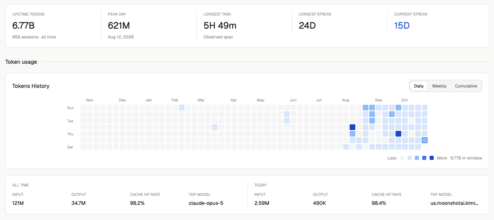

# Insights

A native [Herdr](https://herdr.dev) dashboard for coding-agent token usage.
See which models you use, how usage changes over time, and your daily activity.
Reads local sessions from **Pi, Codex, Claude Code, OpenCode, and Antigravity**.




## Install

Ask your agent:
```
Read https://github.com/GaganSD/coding-agent-toolkit/blob/main/herdr-insights/INSTALL.md and install Insights following it.
```

Or install from a checkout:

```sh
git clone https://github.com/GaganSD/coding-agent-toolkit.git
cd coding-agent-toolkit
npm run install:local --prefix herdr-insights
```

With Herdr running, the installer checks the `insights` mod and adds an
**Insights** button beside the native tabs; clicking it reuses the current
space's dashboard tab, opening one only when absent. It installs `mods/insights/`
and records ownership in `data/insights/`. Shipped files, tabs, keys, terminals,
and usage data are unchanged. See [INSTALL.md](INSTALL.md) for the layout and
click-state rules. Set `HERDR_APP_HOME` to use a different app home.

## Use

- Compare models and providers with period filters and up/down trends.
- Explore a stacked usage chart, daily heatmap, lifetime totals, and streaks.
- Open **Settings** to choose sources, edit paths, toggle cached tokens, or
  change the palette and refresh interval.
- Count usage on your other Herdr machines too. Pick **All machines**, **This
  computer**, or one machine to scope the whole dashboard. Turn a machine off
  under **Settings > Remote machines**.

### Codex accounting

Insights counts recorded response usage, not provider billing. Codex writes
`token_usage_record` before publishing the `token_count` history snapshot that
covers it, even if publishing is deferred (verified at upstream
`8cae463a69aced7705440acaaa9c9cba2d36e056`). The history and response counters
can start at different values; their absolute totals are not compared.

For each thread, Insights counts one record per response ID and max-merges
revisions. An advancing history snapshot contributes only the positive part of
its increment not covered by record increments since the previous snapshot.
For example, an incomplete response without an ID can advance history without
writing a record or replacing `last_token_usage`. A positive residual is kept
even if `last_token_usage` matches an earlier record. One residual counts as one
message; the snapshot cannot tell how many unrecorded responses it represents.
The record's turn and date determine its attribution; an unrecorded residual
uses the publishing snapshot's turn and date. Like the older collector, a
completed turn with no model usage (such as a standalone shell or a manual
compaction without a model call) attaches its duration to the thread's last
usage bucket, if any. It adds no tokens or messages.

Unchanged snapshots do not settle a pending interval. A new zero or synthetic
context-window reset starts a history epoch without adding a message; repeating
an unchanged window fill does not reset it again. A completed turn can leave
records pending for the next history snapshot. Reopening a rollout need not
write another header. When the new last response accounts for the whole history
increase, distinct records from an interrupted turn cannot cover it. The
comparison includes raw input, cache reads, cache writes, output, and reasoning.
Those records still count as spend. A resume without distinguishing history evidence
may be indistinguishable from an ordinary turn. An advancing snapshot cannot
subtract part of a record larger than the increase.

Remote-v2 compaction can spend without advancing history. Its installed marker
excludes the compaction response from the pending balance. A checkpoint can also
recover a missing `latest_token_usage_record` by its own ID, even if the compaction
ID is absent or different. If an attempt
writes a record but never writes its marker, it cannot always be distinguished
from an ordinary deferred response. Cache reads
and writes partition raw input. Classification-only changes do not add spend, and
negative category changes never cancel new raw input or output. A decrease in
raw input or output is treated as a reset of the whole vector. If an imported
log mixes a decrease in one with an increase in the other, that treatment can
retain extra spend rather than discard possible new-epoch usage. The exact
cache split of an unrecorded residual may be unknowable after reclassification.

Older prefixes without records still use legacy accounting. Imported logs that
publish a snapshot before its record, or move a later record ahead of an older
snapshot, can miscount: equal vectors and nearby timestamps are not enough to
identify an echo. When carrier timestamps disagree with rollout order, the
collector reports a bounded warning without changing its accounting. It also
warns on a possible snapshot-first import at the legacy-to-record transition.
For identical snapshots in prefix and suffix copies, the prefix with more usage
carriers normally wins. An identical revised record can also link complementary
fragments, and a verified copy can supply the task's model and day.
Arbitrary overlapping imports without shared carrier identities may still miscount.

Parser upgrades verify the decoded JSONL prefix against evidence rebuilt from
the current index, including after a downgrade and append. Historical parsers
v5–v8 used timestamp-and-total history keys; v9 added per-response keys. A copied
carrier can verify an old entry even if the child does not pay for it, and a
completion only verifies previously indexed time if that time is retained or the
completion is verified copied history. A copied parent task can be retained once
under its original key, even when an old index assigned it to the child file. An auxiliary
observation only verifies spend while its copy is still indexed by the parser
that wrote it. Blank or malformed
lines cannot replace accepted carriers, and a zero-charge snapshot cannot attest
to a missing named response. The scan retains prior counts if response maxima
or indexed task durations cannot be recovered. On failure it warns;
named responses and history increases beyond the old boundary can still count
for the same session. The latter use the retained index's baseline, never a
baseline from the damaged prefix. Completed suffix tasks can also count when
their target is accepted suffix usage. Without a trustworthy baseline,
history-only appends remain ambiguous. v9 did not retain exact line provenance, so replays
that preserve an indexed identity and value cannot be verified byte-for-byte.
During a v9 upgrade, an unreadable copy still owns its legacy contribution; a
readable copy with the same v9 usage key contributes only any uncovered spend.

#### Known limits

- If a rollout resumes without a new header and the old and new usage vectors are indistinguishable, new spend can look already counted. One such rollout yields 4,128 tokens and 2 messages instead of 6,192 and 3.
- If a response record fails to persist, a history snapshot can count its spend first and a later checkpoint can count it again. One such rollout yields 70 tokens and 3 messages instead of 40 and 2.
- Without a compaction marker, a remote compaction response can look like an ordinary response whose history snapshot was deferred.
- A history increase covering several unrecorded responses counts as one inferred message. It cannot recover the individual responses’ times, models, or cache splits.
- Imports that reorder records and snapshots, or overlap without enough shared history, can count too much or too little. Timestamps alone do not identify a response.
- Without a reliable fork boundary or ancestor reference, child spend can be excluded or inherited spend retained. Recognized ambiguous boundaries and unresolved references produce a warning; unrecognized fork metadata may not.
- If an upgrade cannot verify the old prefix, Insights retains the prior index. Without a verified baseline or task target, later history-only spend or task time can remain incomplete until the source is repaired.
- Upgrading a v5 index of copied forks can preserve duplicate task time. With both files live and the parent scanned first, one upgrade retains 13,000 ms where a fresh index gives 10,000 ms. Nested copies can retain duplicate time as well; token and message totals matched in these cases.

#### Fork accounting

For copied forks, an explicitly child-owned settings event establishes the
boundary, even for an equal-millisecond child turn. Paginated subagents can
also use the persisted first-child ordinal or a child-owned record. Older record-less producers can retain the UUIDv7
fallback for turns already inside their copied range. Without reliable ordinal
or ownership evidence, a UUIDv7 child turn must have a strictly newer millisecond.
Equal-millisecond, missing, malformed, or non-v7 turn IDs in that fallback can
exclude child usage and trigger a bounded warning.

A copied history total may establish the child's history baseline. For a
referenced fork, Insights looks up the last history total at the ancestor's
`history_base` byte and inherited ordinal boundary, using the physical rollout
ID rather than its logical session ID. Renamed files without a physical ID can only be resolved when the logical ID and boundary still identify the ancestor.
An inherited-session paginated agent fork filters the ancestor's token history,
so its initial baseline is zero even when the context has a physical reference.
A copied `thread_token_usage` counter never serves as a history baseline. A
paginated root without a history reference uses the history increase like other
roots. A referenced observation can acquire spend when its ancestor becomes
available, even if the provisional charge was zero. If a reference cannot be
verified, inherited and new history-only spend may be indistinguishable;
Insights retains the residual and warns.
Older last-only replay carriers remain compatibility inputs, not an established
current native rollout format. Their copied usage is excluded; when identity is
ambiguous, the scan reports that fork accounting may be inaccurate.

## Privacy

No network requests or uploads. The mod runs a local Node helper, reads session
files and OpenCode/Antigravity SQLite databases, and writes usage metadata to
`~/.config/herdr-app/data/insights/insights.json`. It does not store prompt or
response text or modify source transcripts.

For each other machine connected to Herdr, the mod uses Herdr's own connection
to install its collector under `~/.cache/herdr-insights/` on that machine and
run it there at low priority. Node.js 22.15+ must be on that machine's login
shell `PATH`. The collector groups usage by day in the dashboard's timezone.
After a timezone change, Insights collects again for the new timezone or uses
rows already saved for it.

Transcripts stay on the machine that collected them. Only usage rows come back:
token counts per day, session id, project folder, agent, provider and model,
never prompt or response text. They are saved under
`data/insights/machines/<timezone-key>/`. Two Herdr names for one host count
its usage twice, so turn one of them off.

## Development

One native mod, `mods/insights`, provides both views. A pane whose content is
`{mod: "insights", props: {mode: "toolbar"}}` renders only the button; any other
pane shows the dashboard. Toolbar mode starts no Node helper, scans, tasks,
timers, or editors. No layouts or key bindings ship; the button lives in a
personal layout clone composed by the installer, which wraps the native tabs
without modifying them (see [INSTALL.md](INSTALL.md)).

[RECIPE.md](RECIPE.md) is the self-contained rebuild brief required by Herdr.
Developer tests, fixtures, and release validation live outside this distribution;
see the repo's [development guide](../docs/herdr-insights-development.md). They are
not installation steps.
