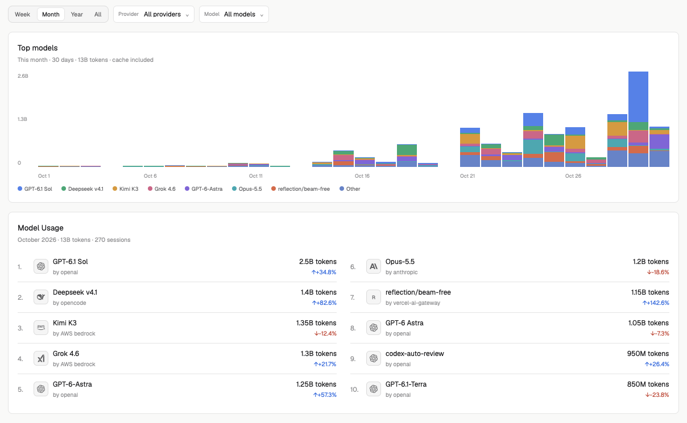

# Insights

A native [Herdr](https://herdr.dev) dashboard for coding-agent token usage.
See which models you use, how usage changes over time, and your daily activity.
Reads local sessions from **Pi, Codex, Claude Code, OpenCode, and Antigravity**.




## Install

Ask your agent:
```
Read https://github.com/GaganSD/coding-agent-toolkit/blob/main/herdr-insights/INSTALL.md and install Insights following it.
```

Or install from a checkout:

```sh
git clone https://github.com/GaganSD/coding-agent-toolkit.git
cd coding-agent-toolkit
npm run install:local --prefix herdr-insights
```

With Herdr running, the installer checks the `insights` mod and adds an
**Insights** button beside the native tabs; clicking it reuses the current
space's dashboard tab, opening one only when absent. It installs `mods/insights/`
and records ownership in `data/insights/`. Shipped files, tabs, keys, terminals,
and usage data are unchanged. See [INSTALL.md](INSTALL.md) for the layout and
click-state rules. Set `HERDR_APP_HOME` to use a different app home.

## Use

- Compare models and providers with period filters and up/down trends.
- Explore a stacked usage chart, daily heatmap, lifetime totals, and streaks.
- Open **Settings** to choose sources, edit paths, toggle cached tokens, or
  change the palette and refresh interval.
- Count usage on your other Herdr machines too. Pick **All machines**, **This
  computer**, or one machine to scope the whole dashboard. Turn a machine off
  under **Settings > Remote machines**.

### Codex accounting

Insights counts recorded response usage, not provider billing. A
`token_usage_record` with a response ID is authoritative for that response.
Codex also emits `token_count` history snapshots, which can repeat, lag behind
the response counter, or arrive out of order. Identified responses and matches
with sufficient counter evidence do not depend on timestamps. Older records
without adequate identity or counters can still use a short compatibility
window. A matched snapshot is suppressed while the response is present; a
surviving snapshot copy can still provide legacy usage on its own.

A bounded scan note marks inferred matches between the separate counters. Anonymous
events cannot always distinguish a repeated snapshot from another response with
the same usage. Readable Codex logs are automatically rescanned once for parser
upgrades. Missing source logs cannot be reconstructed; if a previously indexed
archive cannot be read, its last usable counts are retained and diagnosed.

#### Fork accounting

For fork headers with canonical UUIDv7 thread IDs, Insights excludes replayed
usage until a turn ID has a strictly newer UUIDv7 millisecond. Equal-millisecond,
missing, malformed, or non-v7 turn IDs are ambiguous: child usage can be excluded,
with a bounded scan warning that remains visible even after a later boundary.
Non-v7 initial thread IDs retain the previous accounting behavior. A healthy
unfinished scan slice is not itself an ambiguous boundary; reaching EOF without
a boundary is diagnosed.

Current upstream Codex (`090be4df0724cdef5758e6a0934ba557af8b6bbe`) requires
per-response, turn, and thread usage together, and pairs legacy total and last
usage. Missing-cumulative/last-only records remain compatibility inputs, not an
established current native rollout format. Copied last-only observations use
response IDs or exact legacy record identities, never just equal amounts within
a turn. Mixed carriers lacking a reliable shared identity can be indistinguishable
from distinct responses: Insights retains a bounded diagnostic that accounting
may be inaccurate, preserves trustworthy copied cumulative baselines, and does
not subtract an unidentified last-only echo from them twice. Exact repeated
records are recognized; rewritten echoes without identity cannot be guaranteed.
Production ordering of these historical/imported shapes remains unverified.
Thread-level counters use the same raw fields but can progress independently;
turn-only counters are not treated as thread totals.

## Privacy

No network requests or uploads. The mod runs a local Node helper, reads session
files and OpenCode/Antigravity SQLite databases, and writes usage metadata to
`~/.config/herdr-app/data/insights/insights.json`. It does not store prompt or
response text or modify source transcripts.

For each other machine connected to Herdr, the mod uses Herdr's own connection
to install its collector under `~/.cache/herdr-insights/` on that machine and
run it there at low priority. Node.js 22.15+ must be on that machine's login
shell `PATH`. The collector groups usage by day in the dashboard's timezone.
After a timezone change, Insights collects again for the new timezone or uses
rows already saved for it.

Transcripts stay on the machine that collected them. Only usage rows come back:
token counts per day, session id, project folder, agent, provider and model,
never prompt or response text. They are saved under
`data/insights/machines/<timezone-key>/`. Two Herdr names for one host count
its usage twice, so turn one of them off.

## Development

One native mod, `mods/insights`, provides both views. A pane whose content is
`{mod: "insights", props: {mode: "toolbar"}}` renders only the button; any other
pane shows the dashboard. Toolbar mode starts no Node helper, scans, tasks,
timers, or editors. No layouts or key bindings ship; the button lives in a
personal layout clone composed by the installer, which wraps the native tabs
without modifying them (see [INSTALL.md](INSTALL.md)).

[RECIPE.md](RECIPE.md) is the self-contained rebuild brief required by Herdr.
Developer tests, fixtures, and release validation live outside this distribution;
see the repo's [development guide](../docs/herdr-insights-development.md). They are
not installation steps.
