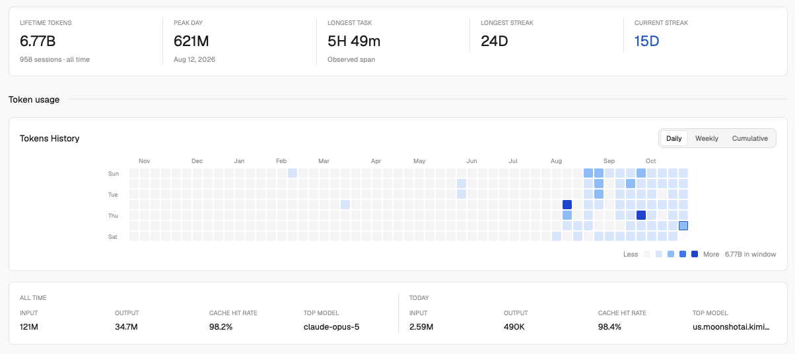
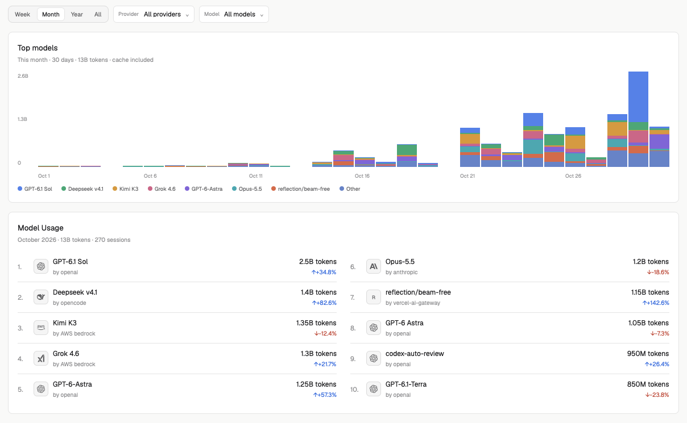

# Insights

A native [Herdr](https://herdr.dev) dashboard for coding-agent token usage.
See which models you use, how usage changes over time, and your daily activity.
Reads local sessions from **Pi, Codex, Claude Code, OpenCode, and Antigravity**.





## Install

Ask your agent:
```
Read https://github.com/GaganSD/coding-agent-toolkit/blob/main/herdr-insights/INSTALL.md and install Insights following it.
```

Or install from a checkout:

```sh
git clone https://github.com/GaganSD/coding-agent-toolkit.git
cd coding-agent-toolkit
npm run install:local --prefix herdr-insights
```

With Herdr running, the installer checks the `insights` mod and adds an
**Insights** button to the tab bar row; clicking it reuses the current
space's dashboard tab, opening one only when absent. On Windows and Linux the
button comes before the tab bar, because that bar draws minimize/maximize/close
at its own end and those stay last; on macOS it follows the bar, clear of the
traffic lights. The bar can be Herdr's `tabs` or a personal clone of it
(`tabs-graph`, ...): both are wrapped, never edited. It installs `mods/insights/`
and records ownership in `data/insights/`. Shipped files, tabs, keys, terminals,
and usage data are unchanged. See [INSTALL.md](INSTALL.md) for the layout and
click-state rules. Set `HERDR_APP_HOME` to use a different app home.

## Use

- Compare models and providers with period filters and up/down trends.
- Explore a stacked usage chart, daily heatmap, lifetime totals, and streaks.
- Open **Settings** to choose sources, edit paths, toggle cached tokens, or
  change the palette and refresh interval.

## Privacy

No network requests or uploads. The mod runs a local Node helper, reads session
files and OpenCode/Antigravity SQLite databases, and writes usage metadata to
`~/.config/herdr-app/data/insights/insights.json`. It does not store prompt or
response text or modify source transcripts.

## Development

One native mod, `mods/insights`, provides both views. A pane whose content is
`{mod: "insights", props: {mode: "toolbar"}}` renders only the button; any other
pane shows the dashboard. Toolbar mode starts no Node helper, scans, tasks,
timers, or editors. No layouts or key bindings ship; the button lives in a
personal layout clone composed by the installer, which wraps the tab-bar block —
Herdr's `tabs` or a personal clone such as `tabs-graph` — without modifying it
(see [INSTALL.md](INSTALL.md)).

[RECIPE.md](RECIPE.md) is the self-contained rebuild brief required by Herdr.
Developer tests, fixtures, and release validation live outside this distribution;
see the repo's [development guide](../docs/herdr-insights-development.md). They are
not installation steps.
