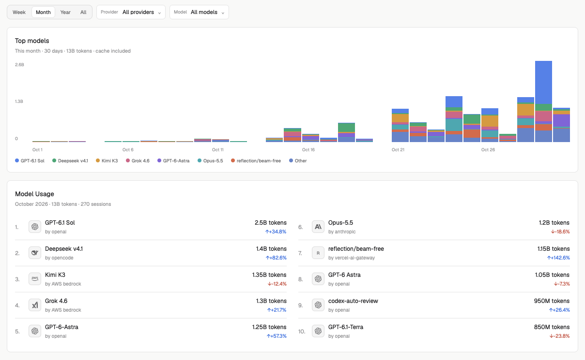

# Insights

A native Herdr dashboard for token usage across Pi, Codex, Claude Code, and
OpenCode. It reads existing local session data, shows model rankings and activity,
and opens in its own tab without changing terminals, layouts, or keys.

The screenshot uses synthetic data for illustration. Never include those rows or
future model names as defaults: the installed mod shows only recorded usage.

**What you see:** A vertically scrollable dashboard centered at a maximum width
of 1180px. Use Herdr theme colors, 1px borders, 8px card corners, 6px control
corners, no decorative shadows, and 4/8/12/16/24px spacing. Page padding is 12px
below 620px, 16px below 900px, and 24px otherwise. Support light and dark themes.

Top to bottom:
- An Insights header with last-update status, Refresh, and Settings.
- Five all-time metrics: tokens, peak-day tokens, longest task, longest streak,
  and current streak. Use 22px values and small uppercase labels; unknown duration
  is a dash. The strip wraps from five columns to three or two on smaller views.
- Token usage: a 53-week, seven-row local-calendar heatmap with month/weekday
  labels and Daily / Weekly / Cumulative controls. Cells are 12–20px squares
  fitted to available width, with 2px gaps; narrow views scroll horizontally.
  Future days are dimmed. Clicking a day updates the detail card.
- Side-by-side all-time and selected-day details: input, output, cache-hit rate,
  and top model. Default the selected day to today.
- Model usage: Week / Month / Year / All controls, a year stepper for Year,
  Provider and Model menus, and Clear filters when a filter is active.
- Top models: a 26-week stacked token chart with date labels, a token axis, and
  a categorical legend. Keep seven model series and fold the rest into Other.
- Model Usage: the top ten models with provider attribution, compact token totals,
  and change versus the previous calendar period. Use two columns at 960px+, one
  below. Show a known model logo, else a provider logo, else an initial. Up/down
  arrows and theme success/destructive colors distinguish trends; handle New and
  no-comparison states. Rows do not expand.

Settings replaces the dashboard content. It contains palette (blue/green/purple),
week start, include-cache, refresh interval, per-source toggles and root editors,
a full JSON editor, and scan status/warnings. No profile/avatar controls.

**How it behaves:** Refresh incrementally on opening and every configured
30–3600 seconds (default 60); prevent overlapping scans. No-op scans do not rewrite
the store. Filters scope only the model chart and leaderboard, not lifetime
metrics or heatmap. Menus cap choices at 250 while retaining selected values.
Week, month, and current-year periods are calendar-to-date; past years are full.
Compare with the same calendar portion of the previous period, clamping month
ends. All has no comparison. The chart always spans 26 weeks ending at the selected
period's end, rather than switching to daily buckets as in the illustrative preview.

Weekly heatmap mode repeats each week's total on every day in that week;
cumulative mode includes all preceding history. A streak ending yesterday still
counts as current. Show explicit loading, empty, and error states, never demo rows
or invented zeros after failures. Settings saves validate before applying; simple
controls preserve custom mappings. Changing source configuration invalidates the
scan cache; palette/cache/week-start/refresh changes preserve collected history.

**Built from:** Put this distribution in `herdr-insights/`, with `RECIPE.md`,
`README.md`, `preview.png`, and `mods/insights/`. Do not include a `layouts/` folder
or keys snippet: no bindings are needed. The recipe heading and `mod.json` title
are **Insights**; the native mod ID is `insights`.

`mods/insights/mod.json` contains `{"place":"none","title":"Insights"}`.
`main.js` default-exports a gpui-kit `View`; use gpui-base flex/controls, `theme()`
semantic colors, `on_size_change`, and fresh callback contexts. Do not retain `cx`.
Cancel tasks/timers and release native editor/input state on close. Use native
animations, never redraw timers. No DOM, web view, shell interpolation, or network.
`ui.js` centralizes surfaces, typography, spacing, and controls; bundle monochrome
provider/model SVGs in `logos/`. Pure `analytics.js` runs in Node and prepares totals,
facets, chart buckets, heatmap, and leaderboard comparisons.

The UI invokes a local Node `presenter.mjs` through Herdr `exec` with separate
argv values. `snapshot` collects then presents; `configure` validates and saves;
`prepare` reads existing metadata and re-derives without scanning or writing.
Keep raw rows and analytics work in Node, not QuickJS rendering. Return a versioned
`insights-presentation` payload with options, compact snapshot metadata, dashboard,
and error. Coalesce filter requests and reject stale results. Send diagnostics to
stderr and surface nonzero exits. Settings controls are initialized lazily.

`collector.mjs` and `core/{config,adapters,scan,store,util}.mjs` implement collection.
Default roots are `~/.pi/agent/sessions`, `~/.codex/sessions`,
`~/.codex/archived_sessions`, `~/.claude/projects`, and `~/.local/share/opencode`.
Read JSONL/zstd transcripts and OpenCode SQLite in read-only mode. The metadata-only
store is `<HERDR_APP_HOME>/data/insights/insights.json`; never save prompt/response
text. Use source-tagged status/warnings for missing, disabled, empty, and failed
sources. Preserve historical rows from removed files until explicit rebuild.

Custom sources use a declarative `mapping`: required `session`, `timestamp`, and
`usage`; optional `messageId`, `project`, `model`, `provider`, `role`, `roles`,
`include`, `taskDurationMs`, and `harness`. Field specs are dot paths,
`{path, default?}`, or `{literal}`. `usage` accepts input, output, cacheRead,
cacheWrite, and reasoning field specs. `roles` filters the mapped role; `include`
is a list of `{path, equals}` or `{path, exists}` conditions. Reject unknown keys
and executable mappings. `core/config.mjs` defines and validates the full schema.

Provide dependency-free Node install/uninstall scripts. Require Node >=22.15 before
writing anything. Install only the mod tree and generate `runtime.json` with the
absolute installer Node path; the UI uses that path, falling back to `node` on PATH
only for manual copies. Track ownership/hashes in a separate install manifest.
Refuse symlinks and unowned collisions; refuse edited owned files unless explicitly
forced. Preserve usage data and unrelated files. Run `herdr-app check` and, only
with `--open`, `herdr-app do tab.new '{"name":"Insights","mod":"insights"}'`.

**Watch out:** Canonical total is input + output + cacheRead + cacheWrite;
input is uncached, output already includes reasoning. Never add reasoning twice.
Reconcile cumulative Codex counters and alternate record formats; deduplicate fork
copies and Claude streamed duplicates. Count Pi's reported usage carriers once,
including tool-result, standalone usage, compaction, and branch-summary events.
Task duration uses exact boundaries or conservative capped spans, never idle session
lifetime. Use local dates, not UTC days. Append-only incremental caches may require
explicit rebuild after same-size rewrites. Use ownership-checked store locks;
never steal live/unknown owners' locks based on age. Preserve corrupt stores with
a backup before rebuilding; read-only prepare must not repair or create stores.

Never write layouts, keys, source transcripts, or an existing user's usage data
from the installer. Do not copy an absolute runtime path from another machine.
The preview is a native UI screenshot with synthetic data; the production dashboard
must not imitate its daily-bucket mock behavior or fabricated model list.

**Done when:** Package tests and checks pass, including distribution naming,
PNG preview, recipe structure, no layouts, token accounting, deduplication,
configuration validation, incremental recovery, and safe installation/uninstallation.
Run `herdr-app check` on the installed mod, plus populated-render and asynchronous
native smoke checks in temporary app homes. Inspect a native screenshot and status
for render errors. Verify actual filters, heatmap modes, source settings, refresh,
and empty/error states. Reinstall without changing source transcripts, layouts,
keys, local edits, or `insights.json`. Keep the GitHub repo public and add topic
`herdr-mod` for Community discovery after merging to the default branch; allow
up to an hour for indexing and at least 24 hours for picture screening.
