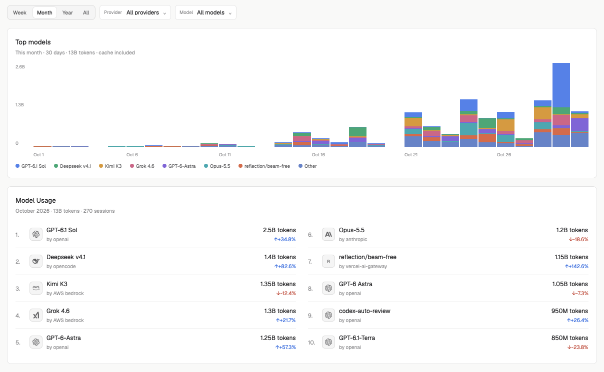

# Insights

A native Herdr dashboard for token usage across Pi, Codex, Claude Code, and
OpenCode. It reads existing local session data, shows model rankings and activity,
and opens in its own tab from an Insights button beside Files and Changes. No
built-in Herdr code, terminals, or keys are changed.

Installing this existing build? Follow [INSTALL.md](INSTALL.md) and the user's
Herdr `AGENTS.md`. This recipe is a rebuild brief; its **Done when** checks apply
to building/releasing, not routine installation. Installation does not launch
smoke-test windows or open a dashboard tab unless requested. First installation
selects a personal layout with the button in the existing toolbar row.

**What you see:** A vertically scrollable dashboard centered at a maximum width
of 1180px. Use Herdr theme colors, 1px borders, 8px card corners, 6px control
corners, no decorative shadows, and 4/8/12/16/24px spacing. Page padding is 12px
below 620px, 16px below 900px, and 24px otherwise. Support light and dark themes.

A separate `insights-launcher` mod draws the **Insights** toolbar button after
Files and Changes. Match Herdr's panel controls: 26px height, 8px horizontal
padding, 5px icon/text gap, 6px corners, 12px type, 14px theme-tinted chart icon,
chrome background, muted text, and native hover colors. Its root matches the tab
bar's chrome background and 1px bottom border. Stop mouse-down propagation on
the button so it does not drag the window. Every click calls `tab.new` with
`{name: "Insights", mod: "insights"}` to create a new dashboard tab in the current
space. No floating window, overlay, polling, file access, or helper process.

Dashboard, top to bottom:
- An Insights header with last-update status, Refresh, and Settings.
- Five all-time metrics: tokens, peak-day tokens, longest task, longest streak,
  and current streak. Use 22px values and small uppercase labels; unknown duration
  is a dash. The strip wraps from five columns to three or two on smaller views.
- Token usage: a 53-week, seven-row local-calendar heatmap with month/weekday
  labels and Daily / Weekly / Cumulative controls. Cells are 12–20px squares
  fitted to available width, with 2px gaps; when even 12px cells cannot fit, the
  grid overflows and stays aligned to the newest weeks. Future days are dimmed.
  Clicking a day updates the detail card.
- Side-by-side all-time and selected-day details: input, output, cache-hit rate,
  and top model. Default the selected day to today.
- Model usage: Week / Month / Year / All controls, a year stepper for Year,
  Provider and Model menus, and Clear filters when a filter is active.
- Top models: a 26-week stacked token chart with date labels, a token axis, and
  a categorical legend. Keep seven model series and fold the rest into Other.
- Model Usage: the top ten models with provider attribution, compact token totals,
  and change versus the previous calendar period. Use two columns at 960px+, one
  below. Show a known model logo, else a provider logo, else an initial. Up/down
  arrows and theme success/destructive colors distinguish trends; handle New and
  no-comparison states. Rows do not expand.

Settings replaces the dashboard content. It contains palette (blue/green/purple),
week start, include-cache, refresh interval, per-source toggles and root editors,
a full JSON editor, and scan status/warnings. No profile/avatar controls.

**How it behaves:** Refresh incrementally on opening and every configured
30–3600 seconds (default 60); prevent overlapping scans. No-op scans do not rewrite
the store. Filters scope only the model chart and leaderboard, not lifetime
metrics or heatmap. Menus cap choices at 250 while retaining selected values.
Week, month, and current-year periods are calendar-to-date; past years are full.
Compare with the same calendar portion of the previous period, clamping month
ends. All has no comparison. The chart always spans 26 weeks ending at the selected
period's end.

Weekly heatmap mode repeats each week's total on every day in that week;
cumulative mode includes all preceding history. A streak ending yesterday still
counts as current. Show explicit loading, empty, and error states, never demo rows
or invented zeros after failures. Settings saves validate before applying; simple
controls preserve custom mappings. Changing source configuration invalidates the
scan cache; palette/cache/week-start/refresh changes preserve collected history.

**Built from:** Put this distribution in `herdr-insights/`, with `RECIPE.md`,
`README.md`, `INSTALL.md`, `preview.png`, `mods/insights/`, and
`mods/insights-launcher/`. Keep developer
tests, fixtures, and release-check tooling outside this distribution folder.
Do not include a `layouts/` folder or keys snippet: no bindings are needed.
The recipe heading and `mod.json` title are **Insights**; the native mod ID is `insights`.

`mods/insights/mod.json` contains `{"place":"none","title":"Insights"}`.
`mods/insights-launcher/mod.json` also uses `place: "none"`, `title: "Insights"`.
Its `main.js` default-exports a small native View using gpui-base flex builders,
`theme()`, and `run()`; bundle its chart icon as `insights.svg`.

`scripts/toolbar.mjs` integrates through layout composition, not source patching.
Use `layout.clone {name: current, as: current + "-insights"}` to preserve Herdr's
appearance/click state. Before cloning, reject symlinked source state or `.state`
parents; choose a numeric suffix if either the destination layout or its state
already exists. Never overwrite another layout's state, including leftover state
from uninstall. Do not edit or remove Herdr-managed click state. In the personal clone only, turn the existing `tabs`
block into a nonresizable row, keeping its ID, height, paint, and window-drag
attributes. Its first child is a weight-1 block with the original `content`
(including its props); its second is a 104px block with `insights-launcher`.
Do not copy or modify the shipped `tabs` mod. Refuse unsupported/ambiguous layouts.
Record the personal layout's name, source, and hash in `toolbar-install.json`.
Reinstall must not rewrite this layout or switch the user's selected layout.
Uninstall validates the original layout and confirms it actually became selected
before deleting an active, unchanged owned clone. Locally edited clones, missing
originals, or unsuccessful switching block removal before deleting any files.
`main.js` default-exports a gpui-kit `View`; use gpui-base flex/controls, `theme()`
semantic colors, `on_size_change`, and fresh callback contexts. Do not retain `cx`.
Cancel tasks/timers and release native editor/input state on close. Use native
animations, never redraw timers. No DOM, web view, shell interpolation, or network.
`ui.js` centralizes surfaces, typography, spacing, and controls; bundle provider/model
SVGs in `logos/`. Some logos carry brand colors, so do not assume they are
monochrome or theme-tintable. Pure `analytics.js` runs in Node and prepares totals,
facets, chart buckets, heatmap, and leaderboard comparisons.

The UI invokes a local Node `presenter.mjs` through Herdr `exec` with separate
argv values. `snapshot` collects then presents; `configure` validates and saves;
`prepare` reads existing metadata and re-derives without scanning or writing.
Keep raw rows and analytics work in Node, not QuickJS rendering. Return a versioned
`insights-presentation` payload with options, compact snapshot metadata, dashboard,
and error. Coalesce filter requests and reject stale results. Send diagnostics to
stderr and surface nonzero exits. Settings controls are initialized lazily.

`collector.mjs` and `core/{config,adapters,scan,store,util}.mjs` implement collection.
Default roots are `~/.pi/agent/sessions`, `~/.codex/sessions`,
`~/.codex/archived_sessions`, `~/.claude/projects`, and `~/.local/share/opencode`.
Read JSONL/zstd transcripts and OpenCode SQLite in read-only mode. The metadata-only
store is `<HERDR_APP_HOME>/data/insights/insights.json`; never save prompt/response
text. Use source-tagged status/warnings for missing, disabled, empty, and failed
sources. Preserve historical rows from removed files until explicit rebuild.

Custom sources use a declarative `mapping`: required `session`, `timestamp`, and
`usage`; optional `messageId`, `project`, `model`, `provider`, `role`, `roles`,
`include`, `taskDurationMs`, and `harness`. Field specs are dot paths,
`{path, default?}`, or `{literal}`. `usage` accepts input, output, cacheRead,
cacheWrite, and reasoning field specs. `roles` filters the mapped role; `include`
is a list of `{path, equals}` or `{path, exists}` conditions. Reject unknown keys
and executable mappings. `core/config.mjs` defines and validates the full schema.

Provide dependency-free Node install/uninstall scripts. The installer requires
Node >=22.15 and validates it before writing anything; the uninstaller intentionally
has no Node gate so it remains usable on older runtimes. Install only these two
mod trees (plus ownership manifests under `data/insights/`) and generate the dashboard's `runtime.json` with the
absolute installer Node path; the UI uses that path, falling back to `node` on PATH
only for manual copies. Track ownership/hashes in a separate install manifest.
Keep the existing dashboard manifest compatible and use
`launcher-install-manifest.json` for the launcher. Preflight both targets before
writing either. Refuse symlinks and unowned collisions; refuse edited owned files
unless explicitly forced. Preserve usage data and unrelated files. Check both
mods with `herdr-app check` before creating/selecting the toolbar layout.
Keep Herdr running for toolbar installation/removal; never start a second instance.

**Watch out:** Canonical total is input + output + cacheRead + cacheWrite;
input is uncached, output already includes reasoning. Never add reasoning twice.
Reconcile cumulative Codex counters and alternate record formats; deduplicate fork
copies and Claude streamed duplicates. Count Pi's reported usage carriers once,
including tool-result, standalone usage, compaction, and branch-summary events.
Task duration uses exact boundaries or conservative capped spans, never idle session
lifetime. Use local dates, not UTC days. Append-only incremental caches may require
explicit rebuild after same-size rewrites. Use ownership-checked store locks;
never steal live/unknown owners' locks based on age. Preserve corrupt stores with
a backup before rebuilding; read-only prepare must not repair or create stores.

Never modify shipped layouts/mods, keys, source transcripts, or existing usage
data. Write only the owned personal layout clone. Preserve collisions and local
edits. Do not copy an absolute runtime path from another machine.

**Done when:** For a new build or release (not an installation), package tests
and checks pass, including distribution naming, PNG preview, recipe structure,
no layouts, token accounting, deduplication, configuration validation, incremental
recovery, and safe installation/uninstallation.
Run `herdr-app check` on both installed mods. Inspect a real screenshot: Insights
must be in the same row as Files/Changes with matching button styling, no extra
strip or floating window. Each click opens a new full-size tab. Confirm built-in
code/layouts are unchanged and reinstall does not duplicate the toolbar. Also run populated-render and asynchronous
native smoke checks in temporary app homes. Inspect a native screenshot and status
for render errors. Verify actual filters, heatmap modes, source settings, refresh,
and empty/error states. Reinstall without changing source transcripts, existing
layouts, keys, local edits, or `insights.json`. Keep the GitHub repo public and add topic
`herdr-mod` for Community discovery after merging to the default branch; allow
up to an hour for indexing and at least 24 hours for picture screening.
