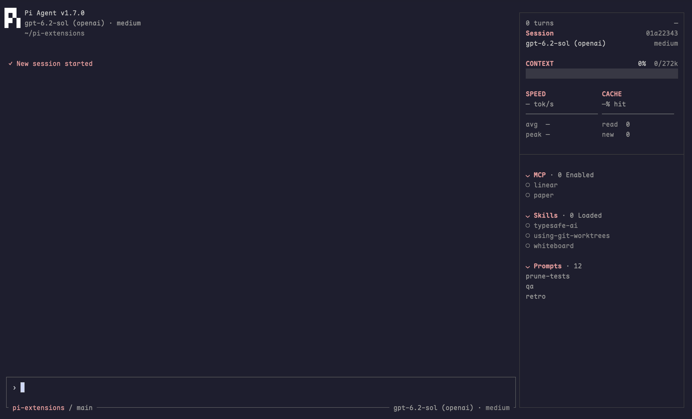
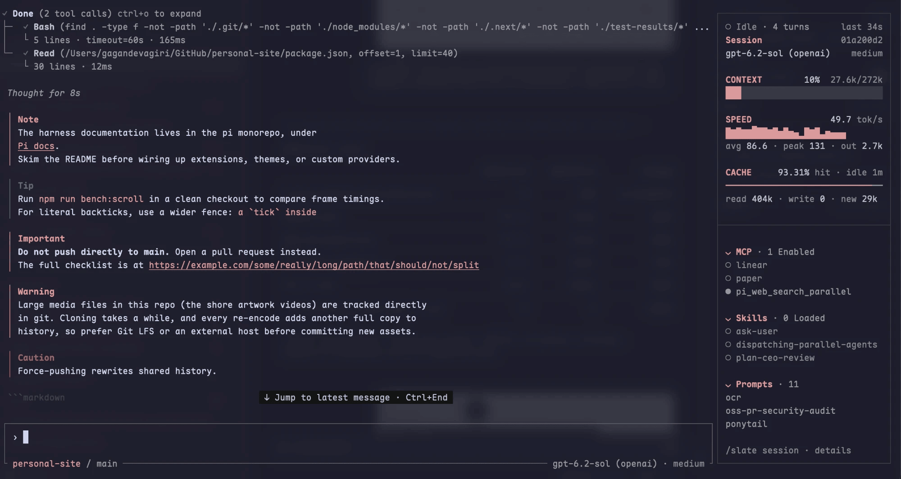
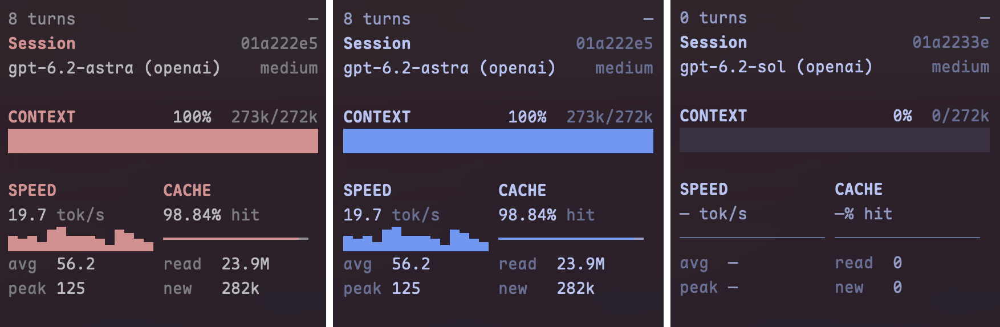
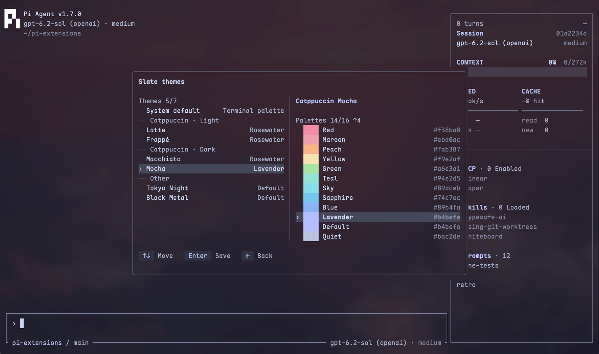
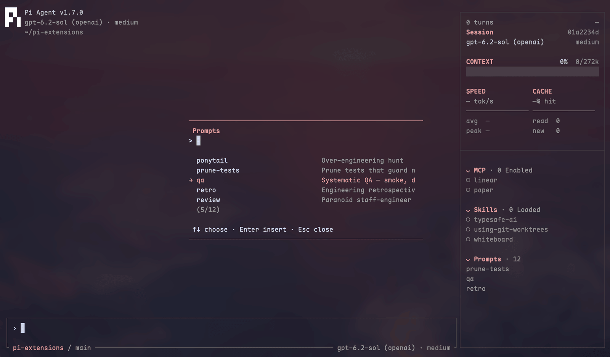
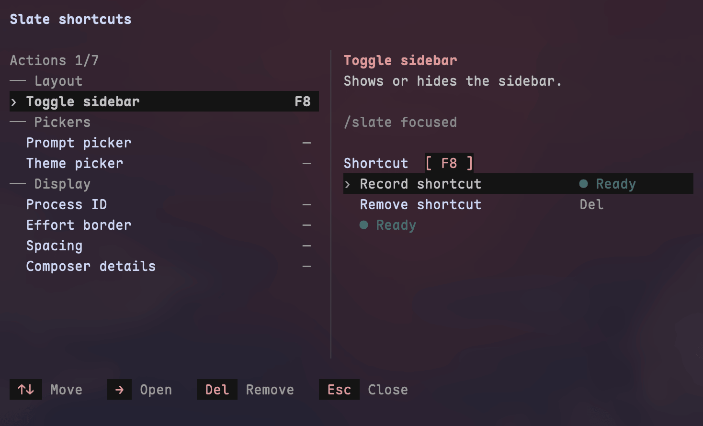

<h1 align="center">Slate 🌱</h1>

<p align="center">
  A minimal-TUI with rich-graphics support that adds zero-context bloat
</p>



<p align="center"><sub><b>Start of a session</b></sub></p>



<p align="center"><sub><b>Working</b>: grouped tool calls, a timed thinking row, GitHub callouts, and the live sidebar</sub></p>



<p align="center"><sub><b>Sidebar Stats</b>: context use, token speed, and cache hits</sub></p>

## Setup

```bash
pi install npm:pi-slate
```

- Use Pi 1.4.0 or later and a terminal that supports the Kitty or iTerm2 image protocol.
- Keep other UI extensions enabled and select only the surfaces you want pi-slate to own.

## Performance Benchmarks

Slate is repeatably benchmarked for performance to check for regression against native Pi. You can read more about Methodology, ablations and full results: [benchmarks](https://github.com/GaganSD/coding-agent-toolkit/tree/main/benchmarks/pi-slate).

| 3,000-entry session · 200×50 terminal | Native Pi | Slate |
|---|---:|---:|
| Frames painted for 800 wheel events | 307 | 305 |
| p95 frame time | 5.1 ms | 7.4 ms |
| Slowest frame | 9 ms | 14 ms |
| p95 frame while a reply streams | 10.2 ms | 8.4 ms |
| CPU while idle (5 s) | 0.00 s | 0.03 s |
| CPU while scrolling | 1.56 s | 2.30 s |

Median of 3 runs per case, with a fixed seed. Apple M2 (8 GB) · macOS · Node.js 24 (24.22.1 for the streaming test) · 200×50 macOS pseudo-terminal (PTY) · Pi 1.6.0 fullscreen.

## Features

### Focused/Vertical Mode

Run `/slate focused on` to hide the sidebar.


### Themes

Open `/theme` to pick a theme and preview its palettes live.\
Choose System default, Catppuccin (Latte, Frappé, Macchiato, or Mocha), Tokyo Night, or Black Metal.



### Rich Media Rendering

> Move the cursor onto an `[image-N]` token to preview the image. Move it off the token to hide the preview. Use the image shelf to open or copy the image, or double-click the image to open it. Slate converts clipboard image paths from Pi into `[image-N]` tokens.


### Working Indicator

Run `/slate progress` to set the animation that shows while the model works.


### Prompt Templates

Run `/prompts` to find a prompt template and insert it into the composer.



### Claude Code Tool Style

Slate groups tool calls in collapsible lists and shows their duration and edit counts.


### Diff

Enable `tool-cards` to show the first 16 lines of a syntax-highlighted diff for `edit` and `write`.\
Expand the tool card to see the full diff.


### Subagents

Use the sidebar to view pi-subagents conversations. Enable `editor` and `sidebar` in fullscreen mode.

### Shortcuts

Open `/shortcuts` to assign keys to Slate actions.



## Composer Keys

These work when `editor` is selected. No terminal configuration.

| Action | Keys |
| --- | --- |
| Select all prompt text | `Ctrl+A` |
| Copy the prompt | `Ctrl+C` |
| Scroll a long prompt | Mouse wheel over the composer |
| Replace or drop a large prompt | `Ctrl+A` then Backspace, or `Esc` `Esc` |
| Submit selected prompt | `Enter` |
| Clear the prompt | `Esc` `Esc` |
| Expand or collapse a paste | Click the `[paste #N]` token |

## Commands

| Command | What it does |
| --- | --- |
| `/slate` | Open Slate's settings menu. |
| `/slate surfaces [set <names...>\|full\|none]` | With no arguments, show saved and active [surfaces](#independent-surfaces). Use `set` with space-separated names, `full` for all, or `none` for none. Changes require `/reload`. |
| `/slate focused [on\|off]` | Hide the sidebar with `on`, restore it with `off`, or toggle with no argument. |
| `/slate pid [on\|off]` | Show or hide the PID on the composer. With no argument, toggle it. Off by default; hidden when the composer is too narrow. |
| `/slate effort-border [on\|off]` | Use Pi's thinking-level and bash-mode colors for the Slate composer frame. With no argument, toggle it. Off by default. |
| `/slate progress [waves\|dna-helix\|snake\|cylon-scanner]` | Set the working animation, or open the picker with no argument. Default: `waves`. |
| `/slate width [default\|narrow\|medium\|wide\|<percent>]` | Set sidebar width and leave focused mode, or open the picker with no argument. Default: 20%, capped at 40 columns. Narrow uses the minimum; medium is 30%, wide is 40%. Custom widths accept `0`–`80`, with or without `%`; `0` means narrow. |
| `/slate message-length [default\|all\|<count>]` | Set the visible chat window with the `transcript` surface enabled, or open the picker with no argument. Default: 100 messages. Accepts `1`–`2000`, or `all` (`unlimited`) to remove the limit. |
| `/slate density [comfortable\|compact]` | Set composer spacing, or open the picker with no argument. |
| `/slate footer [standard\|minimal]` | Set composer details, or open the picker with no argument. `minimal` hides the model and thinking level; this does not change ownership of the `footer` surface. |
| `/logo [original\|minimal]` | Set the stock or white monochrome header mark. With no argument, toggle between them. |
| `/theme` or `/slate theme` | Open the [theme picker](#themes) to preview and save a theme and palette. `/theme slate` is also accepted. |
| `/shortcuts` | Open the [shortcuts panel](#shortcuts). Also available under **Shortcuts** in the `/slate` menu. |
| `/prompts` | Search and insert a prompt template. Available only with the `editor` surface enabled. |
| `/slate diagnostics` | Show which features are active or using fallbacks, with next steps. |
| `/slate bug` | Open the GitHub issue tracker. |
| `/exit` | Quit Pi, like `/quit`. |

## Independent Surfaces

Slate can own one surface and leave the rest untouched. The closed set is `header`, `footer`, `editor`, `sidebar`, `tool-cards`, `transcript`.

Changes are saved and require `/reload`; appearance settings stay live. A fresh install selects `["editor", "sidebar", "tool-cards"]`.

| Surface | Owns |
| --- | --- |
| `header` | Compact workspace identity |
| `footer` | Zero-row footer (hides Pi's native footer) |
| `editor` | Composer, keys, paste/images, working/thinking status |
| `sidebar` | Session dashboard, resources and images |
| `tool-cards` | Highlighted edit/write cards and grouped reads |
| `transcript` | Visible-message window |

## Compatibility and diagnostics

- Use Pi 1.4.0 or later. GitHub callouts require Pi 1.5 or later.
- If a Slate feature is not available, Slate leaves the Pi interface unchanged for that feature.
- Run `/slate diagnostics` to see which features are active and why others are not available.
- Run `/reload` to try again after a failure.

## License

[MIT](LICENSE) © [Gagan Devagiri](https://github.com/GaganSD)
